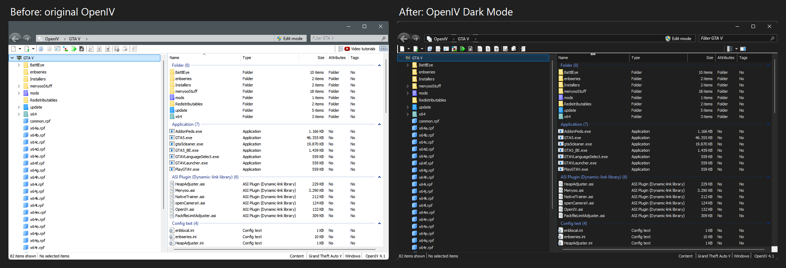
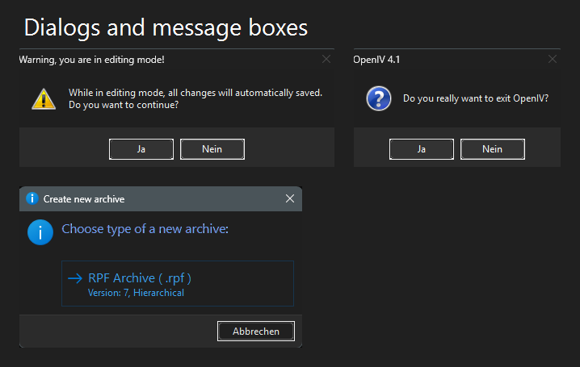
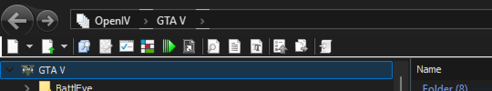

# Open IV Dark-Mode Update (Not OFFICIAL)


Unofficial dark mode for **OpenIV 4.1** (32-bit, Windows 10/11). Not affiliated with New Technology Studio or the OpenIV team. Use at your own risk.

OpenIV has no complete dark mode. This project is a small helper DLL that is loaded when OpenIV starts and converts the window colours to a dark palette. `OpenIV.exe` itself is not modified.

## Preview







## What is dark

- Main window: file list, tree view, column header, group headers, scroll bars, toolbar, address bar, search box, status bar, back / forward buttons
- Title bar (also on a light Windows, and in spite of an accent colour in the title bars)
- Message boxes (for example "Do you really want to exit OpenIV?" and the editing mode warning)
- Task dialogs (for example "Create new archive")

The **Video tutorials** (YouTube) link and the **full screen button** above the file list are hidden by default, because they cannot be made to look right and are rarely used. You can show them again, see Settings.

## Installation

1. Copy `bin/dinput8.dll` (or the one from the [release](../../releases/latest)) into the OpenIV folder, next to `OpenIV.exe`.
2. Start OpenIV.

That is all, there is nothing you have to configure. Everything below is optional. You do **not** need to change `Application.xml`. (An earlier version of this page claimed that `AppColorThemeIndex` darkens the title bar. That was wrong: the title bar is drawn by Windows and is now set dark by the DLL itself.)

## Settings

All settings are optional. To change one, put a text file named `OpenIV-DarkMode.ini` next to `dinput8.dll` (the ZIP contains one with all values and a short explanation) and restart OpenIV. Without the file, or for a missing line, the default applies. Delete the file to go back to the defaults.

```ini
[General]
DarkMode=1
HideButtons=1
Offline=0

[Font]
Scale=100
```

| Setting | Default | Meaning |
|---|---|---|
| `DarkMode` | `1` | `0` keeps OpenIV light, the other settings still apply (the title bar then follows Windows) |
| `HideButtons` | `1` | `0` shows the Video tutorials link and the full screen button again |
| `Offline` | `0` | `1` refuses the requests OpenIV sends to its servers while it starts, see below |
| `Scale` | `100` | Font size in percent, 50 to 300, for example `125` or `150` on a large screen |

### Font size

OpenIV is not DPI aware, so its text gets small on a large screen (for example 2560x1440 at 100 percent). `Scale` enlarges it. What is scaled: the file list, the tree view, the column headers, the status bar and the DLL's own message boxes. What is not: the address bar, the toolbar with its icons and the group headers ("Folder (6)"), because OpenIV gives those a fixed size. When I tried to scale them the text was cut off. At 150 percent and more not every column fits into the window any more, resize the columns by hand. Tested at 125, 150 and 200 percent.

### Offline

While it starts, OpenIV asks one host after the other (`api.openiv.com`, `ntscorp.ru`, `openiv.com`, `openiv.sannybuilder.com`) for store and update information. The original service is no longer maintained, so on a slow or filtered connection the start may wait for these requests to fail. With `Offline=1` the DLL refuses connections to exactly these hosts (subdomains included) at once. Links that open in the browser and every other host are not touched.

The price is that OpenIV can no longer check for updates or load store data. On a normal connection the start is not noticeably faster, because the servers still answer right away. Tested on one PC (no connections at startup, no error message), but not on a really slow or blocked connection.

## Uninstall

Delete or rename `dinput8.dll` in the OpenIV folder.

## How it works

OpenIV loads `dinput8.dll` from its own folder before it looks at the system copy. The DLL forwards `DirectInput8Create` unchanged to the real `dinput8.dll` and, on load, redirects the colour and drawing functions of `OpenIV.exe` and `comctl32.dll` (import table patching). Light colours are darkened and dark text is lightened. In addition:

- the Windows dark mode for lists, trees and scroll bars is switched on,
- every top-level window asks DWM for a dark title bar,
- `MessageBox` calls are answered by a small dark dialog of the same shape (same buttons, icon, default button, keys and return values),
- task dialogs (DirectUI) are darkened after they have been painted, because they draw straight into a bitmap.

## Antivirus false positives

Windows Defender (and possibly other scanners) may flag `dinput8.dll`, for example as `Trojan:Win32/Wacatac.B!ml`. This is a false positive. The `!ml` suffix means a machine-learning verdict from the cloud, and an unsigned DLL that is loaded in place of a system DLL and patches import tables looks similar to malware to such models. The DLL does not open network connections, does not write files and reads nothing but the optional `OpenIV-DarkMode.ini` next to it (apart from loading the real system `dinput8.dll`) and does not install keyboard hooks. You do not have to take my word for it:

- Read the source in `src/darkmode.c`.
- Build the DLL yourself (see below) and use your own copy.
- Compare the SHA-256 checksum of the downloaded file with the one in the release notes, and scan it on [VirusTotal](https://www.virustotal.com/).
- Report the false positive to Microsoft: [Security Intelligence file submission](https://www.microsoft.com/wdsi/filesubmission) (choose "software developer"). The more people report it, the sooner it is fixed.
- If you do not trust it, simply do not use it. Deleting `dinput8.dll` removes everything.

## Building

You need a 32-bit compiler, for example [llvm-mingw](https://github.com/mstorsjo/llvm-mingw):

```
i686-w64-mingw32-windres src/darkmode.rc -O coff -o darkmode.res.o
i686-w64-mingw32-gcc -shared -O2 -o dinput8.dll src/darkmode.c darkmode.res.o -Wl,--kill-at -static -luser32 -lgdi32
```

## Known limitations

- The main window, the two message boxes and the "Create new archive" task dialog are tested. Settings and other dialogs are not, so some light areas may remain there. Task dialogs with other elements (expandable text, check boxes, progress bars) are untested.
- The standard Windows file and folder pickers (open / save, browse for folder) stay light, they are drawn by Windows.
- The font size setting does not scale the address bar, the toolbar and the group headers (see Settings).
- With `DarkMode=0` message boxes and dialogs are the normal light Windows ones.
- The title bar is only tested on Windows 11. On Windows 10 it uses the "immersive dark mode" switch (1809 and newer), which is untested here.
- The colour of the group headers in the file list is tuned for Windows 11 (build 26100) and may look different on other Windows versions.
- It uses undocumented `uxtheme` functions (ordinals 135 and 136) that Windows may change.
- Screens with a very high DPI scaling are untested for the message box.

## Changelog

- **0.1.4** Everything is switched in `OpenIV-DarkMode.ini`: `DarkMode` (keep OpenIV light), `HideButtons` (keep the Video tutorials link and the full screen button), `Offline` (no start-up requests to the OpenIV servers, replaces the separate offline build) and `Scale`. Defaults are unchanged: dark, buttons hidden, online, 100 percent.
- **0.1.3** Adjustable font size through `OpenIV-DarkMode.ini` (asked for by a user with a 2K screen). The optional offline variant is part of this release now.
- **0.1.2 offline** (pre-release) The same as 0.1.2, but refuses the start-up requests to the unmaintained OpenIV servers.
- **0.1.2** Dark title bars on every Windows theme, dark message boxes and task dialogs, visible drop-down arrows (also on hover), removed the Video tutorials link and the full screen button, README correction (no `Application.xml` change needed).
- **0.1.1** No keyboard-hook API, version information in the DLL, notes about antivirus false positives.
- **0.1.0** First release.

## Contributing

Everyone may develop this further, fork it and improve it (MIT license, see `LICENSE`). Improvements, bug reports with a screenshot and pull requests are welcome. Especially helpful would be testing the other dialogs and settings windows, and feedback on other Windows versions.
