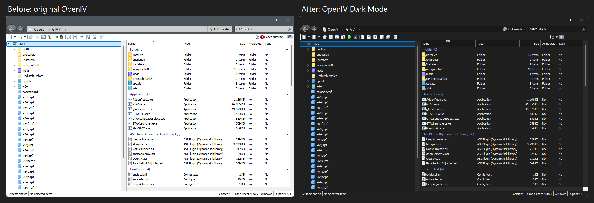
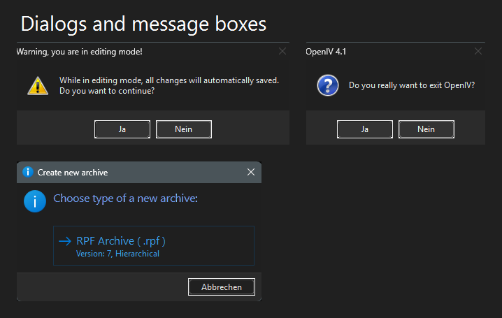
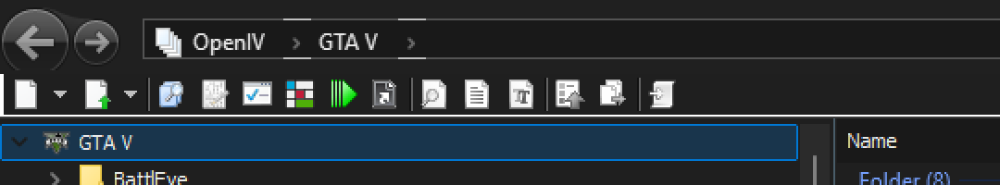

# Open IV Dark-Mode Update (Not OFFICIAL)


Unofficial dark mode for **OpenIV 4.1** (32-bit, Windows 10/11). Not affiliated with New Technology Studio or the OpenIV team. Use at your own risk.

OpenIV has no complete dark mode. This project is a small helper DLL that is loaded when OpenIV starts and converts the window colours to a dark palette. `OpenIV.exe` itself is not modified.

## Preview







## What is dark

- Main window: file list, tree view, column header, group headers, scroll bars, toolbar, address bar, search box, status bar, back / forward buttons
- Title bar (also on a light Windows, and in spite of an accent colour in the title bars)
- Message boxes (for example "Do you really want to exit OpenIV?" and the editing mode warning)
- Task dialogs (for example "Create new archive")

Two things are removed on purpose, because they cannot be made to look right and are rarely used: the **Video tutorials** (YouTube) link and the **full screen button** above the file list.

## Installation

1. Copy `bin/dinput8.dll` (or the one from the [release](../../releases/latest)) into the OpenIV folder, next to `OpenIV.exe`.
2. Start OpenIV.

That is all, there is nothing to configure. You do **not** need to change `Application.xml`. (An earlier version of this page claimed that `AppColorThemeIndex` darkens the title bar. That was wrong: the title bar is drawn by Windows and is now set dark by the DLL itself.)

## Uninstall

Delete or rename `dinput8.dll` in the OpenIV folder.

## How it works

OpenIV loads `dinput8.dll` from its own folder before it looks at the system copy. The DLL forwards `DirectInput8Create` unchanged to the real `dinput8.dll` and, on load, redirects the colour and drawing functions of `OpenIV.exe` and `comctl32.dll` (import table patching). Light colours are darkened and dark text is lightened. In addition:

- the Windows dark mode for lists, trees and scroll bars is switched on,
- every top-level window asks DWM for a dark title bar,
- `MessageBox` calls are answered by a small dark dialog of the same shape (same buttons, icon, default button, keys and return values),
- task dialogs (DirectUI) are darkened after they have been painted, because they draw straight into a bitmap.

## Antivirus false positives

Windows Defender (and possibly other scanners) may flag `dinput8.dll`, for example as `Trojan:Win32/Wacatac.B!ml`. This is a false positive. The `!ml` suffix means a machine-learning verdict from the cloud, and an unsigned DLL that is loaded in place of a system DLL and patches import tables looks similar to malware to such models. The DLL does not open network connections, does not read or write files (apart from loading the real system `dinput8.dll`) and does not install keyboard hooks. You do not have to take my word for it:

- Read the source in `src/darkmode.c`.
- Build the DLL yourself (see below) and use your own copy.
- Compare the SHA-256 checksum of the downloaded file with the one in the release notes, and scan it on [VirusTotal](https://www.virustotal.com/).
- Report the false positive to Microsoft: [Security Intelligence file submission](https://www.microsoft.com/wdsi/filesubmission) (choose "software developer"). The more people report it, the sooner it is fixed.
- If you do not trust it, simply do not use it. Deleting `dinput8.dll` removes everything.

## Building

You need a 32-bit compiler, for example [llvm-mingw](https://github.com/mstorsjo/llvm-mingw):

```
i686-w64-mingw32-windres src/darkmode.rc -O coff -o darkmode.res.o
i686-w64-mingw32-gcc -shared -O2 -o dinput8.dll src/darkmode.c darkmode.res.o -Wl,--kill-at -static -luser32 -lgdi32
```

## Known limitations

- The main window, the two message boxes and the "Create new archive" task dialog are tested. Settings and other dialogs are not, so some light areas may remain there. Task dialogs with other elements (expandable text, check boxes, progress bars) are untested.
- The standard Windows file and folder pickers (open / save, browse for folder) stay light, they are drawn by Windows.
- The title bar is only tested on Windows 11. On Windows 10 it uses the "immersive dark mode" switch (1809 and newer), which is untested here.
- The colour of the group headers in the file list is tuned for Windows 11 (build 26100) and may look different on other Windows versions.
- It uses undocumented `uxtheme` functions (ordinals 135 and 136) that Windows may change.
- Screens with a very high DPI scaling are untested for the message box.

## Changelog

- **0.1.2** Dark title bars on every Windows theme, dark message boxes and task dialogs, visible drop-down arrows (also on hover), removed the Video tutorials link and the full screen button, README correction (no `Application.xml` change needed).
- **0.1.1** No keyboard-hook API, version information in the DLL, notes about antivirus false positives.
- **0.1.0** First release.

## Contributing

Everyone may develop this further, fork it and improve it (MIT license, see `LICENSE`). Improvements, bug reports with a screenshot and pull requests are welcome. Especially helpful would be testing the other dialogs and settings windows, and feedback on other Windows versions.
